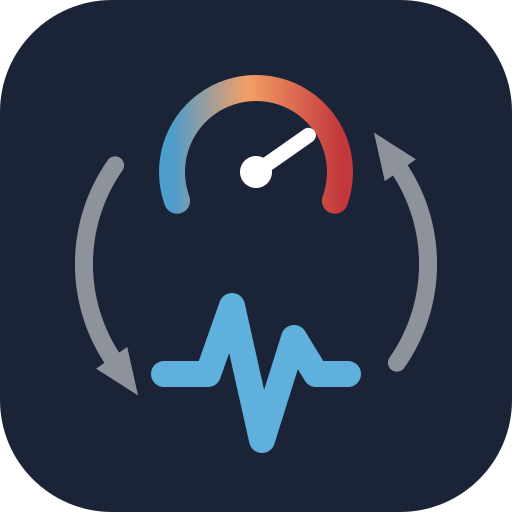
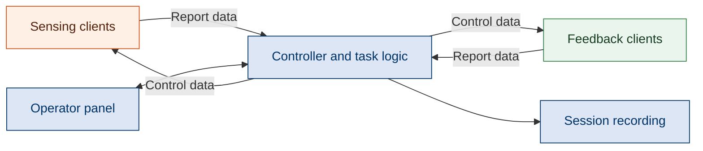

<p align="center">
  
</p>

<h1 align="center">PainLabPlatform</h1>

<p align="center">
  A flexible platform for multisensory pain research and closed-loop experimentation.
</p>

<p align="center">
  <a href="LICENSE"></a>
  <a href="package.json"></a>
  <a href="docs/device-integration.md"></a>
</p>

<p align="center">
  <a href="docs/getting-started.md">Getting started</a> ·
  <a href="docs/README.md">Documentation</a> ·
  <a href="#research">Research</a> ·
  <a href="CONTRIBUTING.md">Contributing</a>
</p>

## Why PainLabPlatform?

Pain research often combines participant behavior, physiological measurements,
immersive environments, and adaptive feedback. PainLabPlatform brings these
components into a shared event-driven framework so device integrations can be
reused as experimental paradigms evolve.

- **Describe devices:** a common descriptor defines report data, control data,
  and their presentation.
- **Define task logic:** JavaScript scripts express experimental contingencies
  using incoming events and outgoing commands.
- **Shape operator controls:** declarative settings generate live readouts and
  adjustable parameters in the control panel.

The desktop application brings together device management, visualization,
operator actions, and session recording.

## How it works

Devices and software clients communicate through a central controller. They
send **report data** and receive **control data**; task scripts connect the two.



See the [architecture overview](docs/architecture.md) for the main components.

## Getting started

Install Node.js and npm, then prepare the local workspace folders using the
[setup guide](docs/getting-started.md). From the repository root:

```sh
npm ci
npm start
```

Electron is installed with the dependencies. Connect your devices and add task
configuration under `instance/` to assemble a paradigm.

The experiment-specific `instance/` configuration is provided separately for each published study;

## Choose your path

| I want to… | Start here |
| --- | --- |
| Operate an assembled paradigm through the control panel | [User guide](docs/user-guide.md) |
| Adapt experimental logic and operator controls | [Task scripting](docs/task-scripting.md) |
| Connect a device or software client | [Device integration](docs/device-integration.md) |
| Save and export a session | [Recording](docs/recording.md) |
| Work on the platform itself | [Development](docs/development.md) |

Operating an assembled paradigm uses the graphical interface. Authoring task
logic requires JavaScript; new device integrations require device-side development.

## Repository layout

```text
assets/     Project icon and visual assets
backend/    Device communication and session recording
frontend/   Control panel and task execution
clients/    Python and C# protocol client source
instance/   Local tasks, actions, libraries, devices, and data
tools/      Session export utilities
tests/      Integration test
docs/       Guides and interface overviews
```

See [instance layout](docs/instance-layout.md) for local folder conventions and
the [documentation index](docs/README.md) for all guides.

## Research

PainLabPlatform supports research into context-rich paradigms and their clinical
translation. The accompanying manuscript is under review and describes
behavioral and neural adaptive control.

See [research context](docs/research-context.md). Publication and citation details
will be added when available; for now, identify the repository revision used
when reporting work based on PainLabPlatform.

## Contributing and support

Contributions to documentation, device integration, and the platform are welcome.
Use this repository's issue tracker for questions, reproducible problems, and
proposals. Read the [contribution guide](CONTRIBUTING.md) before submitting changes.

## License

PainLabPlatform is available under the [MIT License](LICENSE).
